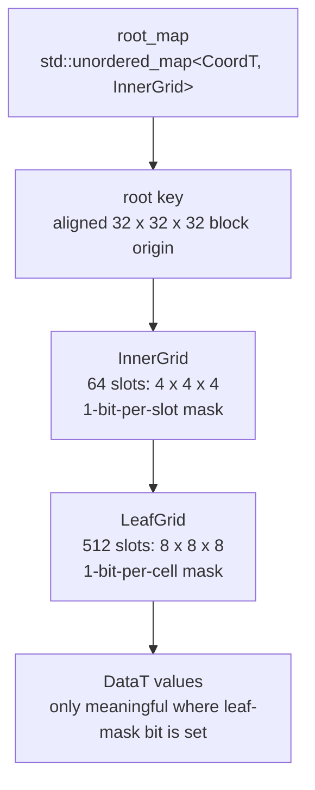
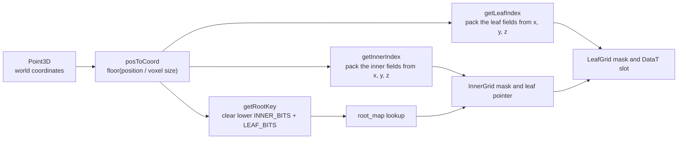
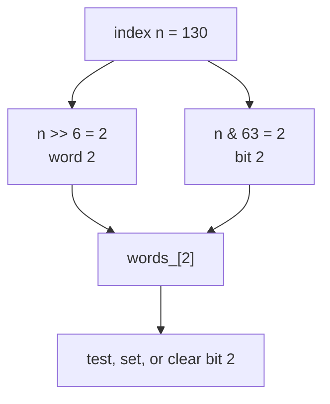
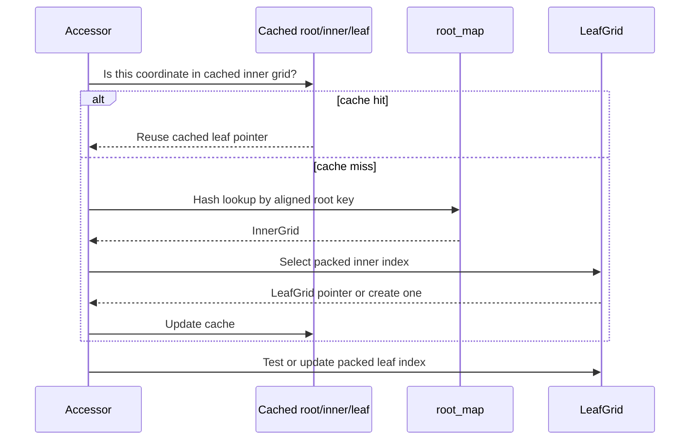

# Bonxai Architecture Guide

Bonxai is a compact sparse voxel-grid library. It represents an unbounded logical
three-dimensional grid, but allocates storage only for root blocks, leaf grids,
and cells that are used. The core implementation is header-only and is centered
on `Bonxai::VoxelGrid<DataT>`.

This guide describes the implementation in this repository. The default grid
configuration is used in most examples:

| Setting | Default | Meaning |
| --- | ---: | --- |
| `INNER_BITS` | 2 | A root block has $2^2 = 4$ leaf-grid positions per axis. |
| `LEAF_BITS` | 3 | A leaf grid has $2^3 = 8$ voxel positions per axis. |
| `Log2N` | 5 | A root block spans $2^5 = 32$ voxels per axis. |

Therefore, one root block covers $32^3$ logical voxel positions. It does not
allocate all of those positions merely because the block exists.

## Storage Hierarchy



The root map is sparse and unbounded because a `CoordT` root key can be created
wherever it is needed. An `InnerGrid` contains pointers to possible leaf grids.
The inner mask says which of those pointers are valid. A `LeafGrid` contains the
cell values and a second mask that says which cell values are logically active.

`BinaryVoxelGrid` is `VoxelGrid<EmptyVoxel>`. It uses the same hierarchy and
leaf mask, but omits per-cell value storage: a set bit alone represents an
occupied cell.

## From World Point to Voxel

The grid first converts metric coordinates to integer voxel coordinates:

$$
\mathrm{coord} = \lfloor \mathrm{position} / \mathrm{voxel\_size} \rfloor
$$

For a 5 cm voxel size, `(2.25, -0.10, 0.18)` becomes `(45, -2, 3)`.

Each integer coordinate is split into three bit fields:

```text
coordinate bits: [ root-block bits ... ][ inner bits ][ leaf bits ]
default widths:                            2 bits       3 bits
```



### Root Key

`getRootKey()` uses:

```cpp
const int32_t mask = ~((1 << Log2N) - 1);
return {coord.x & mask, coord.y & mask, coord.z & mask};
```

With the defaults, `Log2N` is 5 and the mask is `...11100000`. It clears the
five low bits of every axis, yielding the aligned origin of the 32-voxel root
block. For example, `45` becomes `32`; `-2` becomes `-32` on the two's-complement
machines targeted by the library.

### Packed Inner and Leaf Indices

The lower bits are converted into dense integer indices for the masks and grid
arrays. The packing order is x in the low bits, then y, then z:

```text
inner_index: [ z: INNER_BITS ][ y: INNER_BITS ][ x: INNER_BITS ]
leaf_index:  [ z: LEAF_BITS  ][ y: LEAF_BITS  ][ x: LEAF_BITS  ]
```

For x-coordinate 45 with default settings:

```text
45 decimal = 0b00101101

root field:  0b001      -> root origin 32
inner field: 0b01       -> leaf position 1 in the root block
leaf field:  0b101      -> voxel position 5 in that leaf

32 + (1 * 8) + 5 = 45
```

The masks used to extract those fields are:

```cpp
LEAF_MASK  = (1 << LEAF_BITS) - 1;   // 0b111 by default
INNER_MASK = (1 << INNER_BITS) - 1;  // 0b11 by default
```

The actual index formulas are equivalent to:

```cpp
inner_index = ((x >> 3) & 0b11) |
              (((y >> 3) & 0b11) << 2) |
              (((z >> 3) & 0b11) << 4);

leaf_index = (x & 0b111) |
             ((y & 0b111) << 3) |
             ((z & 0b111) << 6);
```

These operations are shifts, masks, and bitwise ORs, so they avoid coordinate
objects, divisions, or tree traversal after the initial point conversion.

## Masks: Sparse Topology and Fast Scans

`Mask` is a dense bitmap. Bit `n` is held in `words_[n / 64]` at bit position
`n % 64`, implemented with shifts that are efficient for powers of two:

```cpp
const uint64_t bit = uint64_t(1) << (n & 63);
bool is_on = words_[n >> 6] & bit;
```



At the default dimensions, the inner grid has 64 slots, needing one 64-bit
word. The leaf grid has 512 slots, needing eight words. Both fit in the `Mask`
class's inline `static_words_` storage, avoiding an allocation for their masks.

When a caller writes a previously unseen voxel, `Accessor::getLeafGrid()` sets
the relevant inner-mask bit. If it was previously off, it allocates a leaf grid.
Then `setValue()` or `setCellOn()` sets the leaf-mask bit. Read operations test
the leaf mask before treating the corresponding value slot as present.

The masks also make iteration proportional to occupancy. `findNextOn()` skips
zero 64-bit words and uses `__builtin_ctzll` on GCC or Clang to find the least
significant set bit in a nonzero word. This normally maps to a single CPU
bit-scan instruction. `forEachCell()` visits only set inner-mask bits, then only
set leaf-mask bits; it does not inspect every possible $32^3$ cell in a root
block.

## Accessor Cache

Accessors cache the last root, inner, and leaf grid used:



Spatially coherent workloads, such as inserting a point cloud ordered by nearby
points, frequently reuse the same leaf grid. In that case, the common path
avoids another root-map lookup and only computes the leaf index and tests or
updates one bit.

Writes to `VoxelGrid` are not thread-safe. Concurrent read-only use is supported
when every thread uses its own `ConstAccessor`; each accessor has mutable cache
state.

## Root-Map Hash

The root map uses this `std::hash<CoordT>` specialization:

```cpp
((1 << 20) - 1) &
    (int64_t(p.x) * 73856093 ^
     int64_t(p.y) * 19349669 ^
     int64_t(p.z) * 83492791)
```

The three distinct large multipliers mix the predictable, aligned root
coordinates before the axis contributions are combined with XOR. The final mask
retains 20 bits, limiting the direct hash output to $2^{20}$ values. This is a
cheap spatial hash, not a unique coordinate encoding or a cryptographic hash.

Hash collisions do not affect correctness. `std::unordered_map` resolves them
by calling `CoordT::operator==`, which compares x, y, and z exactly. Collisions
only add comparisons within a bucket, so a good distribution preserves the
expected average $O(1)$ root lookup.

## Reconstructing Coordinates During Iteration

`forEachCell()` reverses the packed-index process. For each root key, it decodes
the inner index into a leaf-grid origin, then decodes the leaf index into the
final voxel coordinate:

```text
root origin        = aligned root key
leaf-grid origin   = root origin OR (decoded inner offset << LEAF_BITS)
voxel coordinate   = leaf-grid origin OR decoded leaf offset
```

Bitwise OR is valid here because each component owns a different bit range:
root-origin low bits are zero, then the inner field occupies the next range, and
the leaf field occupies the low range. Numerically, OR and addition give the
same result for these non-overlapping fields.

## Memory Behavior

Bonxai is sparse in topology, not necessarily in every byte of a value leaf.
For a non-`EmptyVoxel` `DataT`, a newly allocated leaf grid contains storage for
all of its $2^{3 \cdot \mathrm{LEAF\_BITS}}$ value slots. Its mask controls which
slots are active. The hierarchy therefore works especially well when active
voxels cluster into shared leaves. A very isolated point can still require one
leaf's value array and metadata.

For trivial non-empty `DataT`, `GridBlockAllocator` allocates leaf value blocks
in chunks of 512 leaves. This reduces individual allocation overhead and improves
allocation locality. `releaseUnusedMemory()` removes leaf grids whose cell mask
is empty, clears their inner-mask bits, erases root entries with no active leaves,
and asks the allocator to release completely unused chunks.

## Relationship to OpenVDB

Bonxai is explicitly influenced by the VDB data structure and reuses several
ideas found in OpenVDB and the VDB paper:

| Shared idea | How it appears in Bonxai |
| --- | --- |
| Hierarchical sparse grid | Hash-addressed root blocks, dense child grids, and leaf grids. |
| Dynamic topology | Masks track which child nodes and voxels are active. |
| Bit-packed coordinates | Coordinate fields select nodes and dense local indices. |
| Efficient active-voxel iteration | Bit scans skip inactive regions. |
| Spatial hashing | The `CoordT` hash states it uses the same formula as OpenVDB. |

Conceptually, both designs organize voxels into fixed-size dense regions and use
sparse topology between those regions. This provides much better locality than a
pointer-heavy per-voxel tree while retaining an effectively unbounded domain.

### Where Bonxai Deliberately Differs

| Area | Bonxai | OpenVDB |
| --- | --- | --- |
| Core tree | A root hash map, one `InnerGrid` level, and leaves. | A configurable multi-level tree architecture with a root node, internal nodes, and leaf nodes. |
| Scope | Small header-only voxel container focused on direct C++ integration. | Broad production ecosystem for sparse volumetric data, with extensive APIs, tools, I/O, and integrations. |
| Topology representation | `Mask` plus `std::shared_ptr<LeafGrid>` in each inner slot. | Specialized node types and richer value/topology mechanisms, including tiles. |
| Value leaves | Dense `DataT` array plus active-cell bitmap, except binary grids. | Richer leaf/node representations and metadata designed for OpenVDB's general feature set. |
| Transform support | One scalar voxel size and direct floor-based coordinate conversion. | General transforms that map index space to world space, including non-uniform and affine transforms. |
| Serialization | Simple template serialization for trivially copyable values. | A mature native file format and ecosystem for transporting volumetric grids. |
| Optimization target | Minimal implementation and low overhead for its use cases. | Generality, interoperability, and scalable sparse-volume workflows. |

These are architectural differences, not a claim that one library supersedes the
other. Bonxai trades breadth and generality for a smaller implementation and a
direct mapping from the common voxel-grid operations to a few inexpensive
operations: hash lookup, packed index calculation, bitmap test, and array access.

## Practical Use Pattern

```cpp
Bonxai::VoxelGrid<float> grid(0.05);
auto accessor = grid.createAccessor();

const Bonxai::CoordT cell = grid.posToCoord(2.25, -0.10, 0.18);
accessor.setValue(cell, 42.0F);

grid.forEachCell([](const float& value, const Bonxai::CoordT& coord) {
  // Called only for active cells.
});
```

Create an accessor once and reuse it for a batch of related reads or writes.
Use `setCellOn`, `setCellOff`, and `isCellOn` for a `BinaryVoxelGrid`; it has no
cell value to read or write. After bulk removals, use `releaseUnusedMemory()` if
reclaiming empty leaves and root blocks is useful; any existing accessors must
then be discarded and recreated.